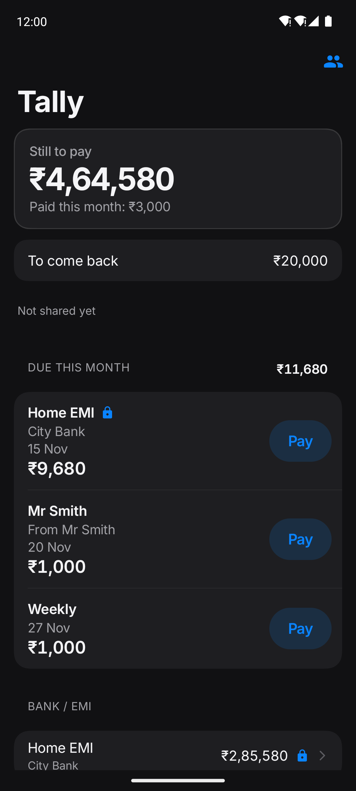
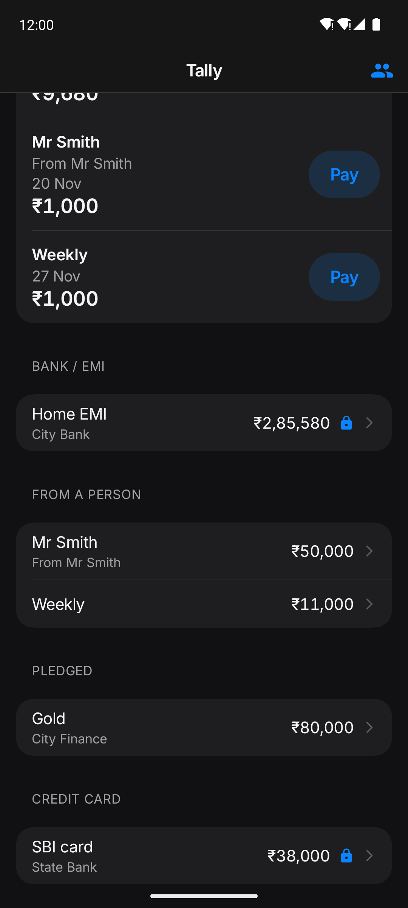
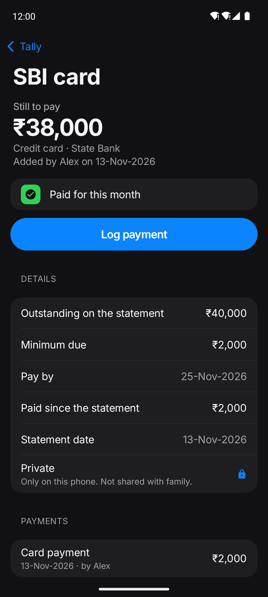
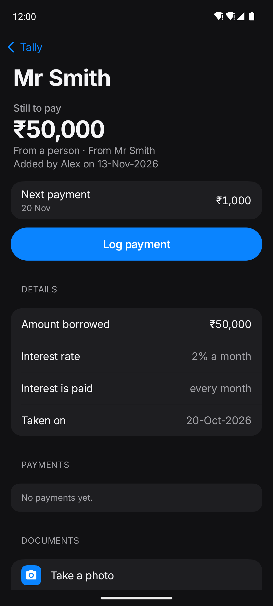
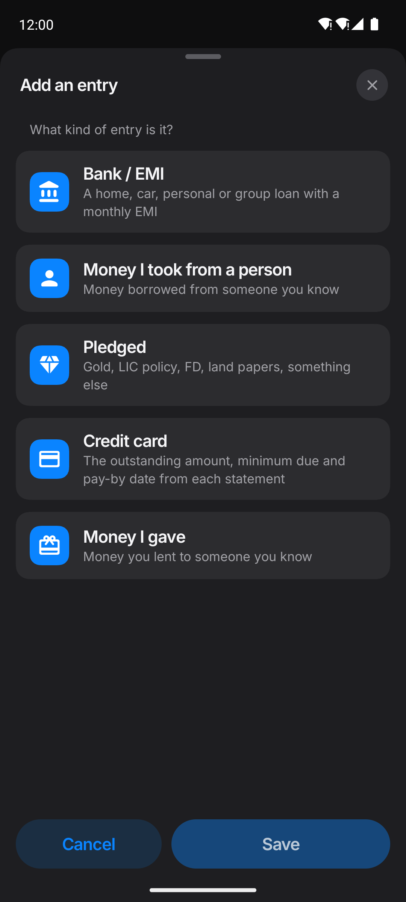
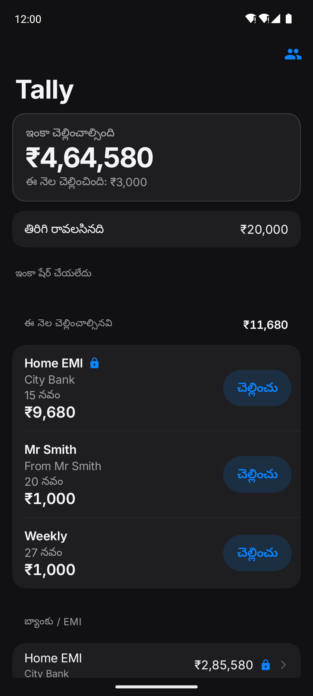

<div align="center">


# Tally

**Your family's book, shared.**

Track what your family owes and lends, and keep everyone in the family on the same page.

[](https://appdrop-store.vercel.app/apps/tally)


[](LICENSE)

</div>

<table>
  <tr>
    <td align="center" width="33%"><br><sub><b>What's due this month</b></sub></td>
    <td align="center" width="33%"><br><sub><b>Grouped by kind, private ones locked</b></sub></td>
    <td align="center" width="33%"><br><sub><b>Credit cards</b></sub></td>
  </tr>
  <tr>
    <td align="center"><br><sub><b>Money from people you know</b></sub></td>
    <td align="center"><br><sub><b>Five kinds of entry</b></sub></td>
    <td align="center"><br><sub><b>Telugu, Hindi and English</b></sub></td>
  </tr>
</table>

## ✨ What it does

| | |
|---|---|
| 📅 **Due this month** | What is still to pay, what is due this month with the month's total, and what is overdue |
| 🏦 **Every kind of debt** | Bank EMIs (reducing or flat), interest only (every month, 3 or 6 months, or a year), no interest, or fixed instalments such as ₹1,000 a week |
| 💳 **Credit cards** | Outstanding, minimum due and pay-by date, statement and due days, credit limits, and limits shared between cards |
| 🗓️ **Real payment dates** | Set the first payment date, so payments can fall on a different day from the day the money came |
| 🧾 **Every payment logged** | With a bank SMS, a photo or a document if you like |
| 👨‍👩‍👧 **Shared with family** | Say whose each entry is, and switch between **Everyone** and **Mine** |
| 🔒 **Private entries** | Kept on your phone only, marked with a lock |
| ♻️ **Recently deleted** | A deleted entry stays for 30 days, and anyone in the family can bring it back |
| 🌐 **Three languages** | Telugu, Hindi and English, with an Easy mode for bigger text and fewer choices |
| 🔔 **Reminders** | A quiet morning reminder when a payment is due, and a home-screen widget |

## 🔐 Privacy

> **Private by design:** your family's book stays on your phone, and sharing is end-to-end encrypted.

- **No account.** No sign-up, no ads, no analytics, no tracking.
- **Encrypted before it leaves the phone.** The small server that passes changes between family phones (a Supabase project reached only through `tally_*` database functions) holds only ciphertext, and keeps files only until every member has them.
- **The keys stay with the family.** A family's keys never reach the server. Joining needs an admin's approval on their phone; removing someone changes the keys.
- **Private means private.** Private entries, their payments and their documents never leave the phone, except inside a backup file you make.
- **Locked if you like.** An optional lock (a PIN, or the phone's own lock) seals the book on the phone, with a recovery code for backups.

How it works and the threat model are in [docs/DESIGN.md](docs/DESIGN.md); the security review and its fixes are in [docs/SECURITY_REVIEW.md](docs/SECURITY_REVIEW.md).

## 🛠️ Building

Native Kotlin and Jetpack Compose in `android/` (package `com.tally.book`, Android 10+).

```bash
export ANDROID_HOME=~/android-sdk
cd android
./gradlew testDebugUnitTest   # unit tests
./gradlew assembleDebug       # app/build/outputs/apk/debug/
```

Family sharing needs a relay: set its address and publishable key as Gradle properties (`TALLY_SUPABASE_URL`, `TALLY_SUPABASE_ANON_KEY`, for example in `~/.gradle/gradle.properties`) and apply `supabase/migrations/` to your own Supabase project. Without them the app works fully on one phone. Release builds also need a signing key (`TALLY_STORE_*`), which is never in this repository.

```
android/     the app (core, model, data, sync, ui, widget) and its tests
supabase/    the relay: migrations and config
docs/        DESIGN.md (how it works) and SECURITY_REVIEW.md
appdrop/     the store listing: description, icon, screenshots
scripts/     release.sh
```

## 📄 License

Open source under the [MIT License](LICENSE). Issues and contributions are welcome.
